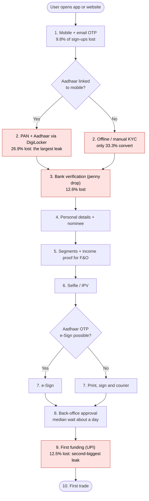
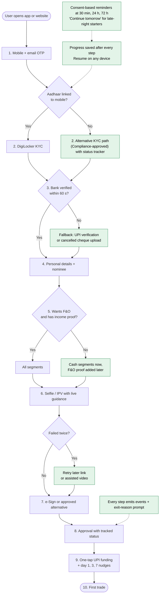
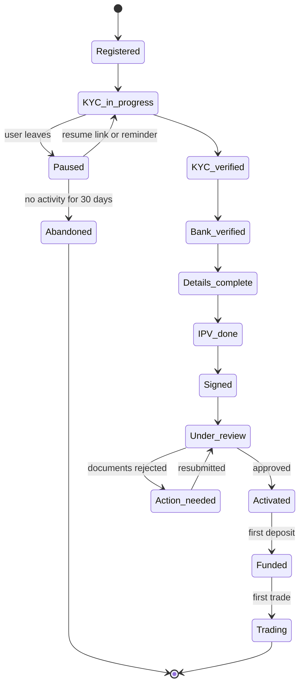
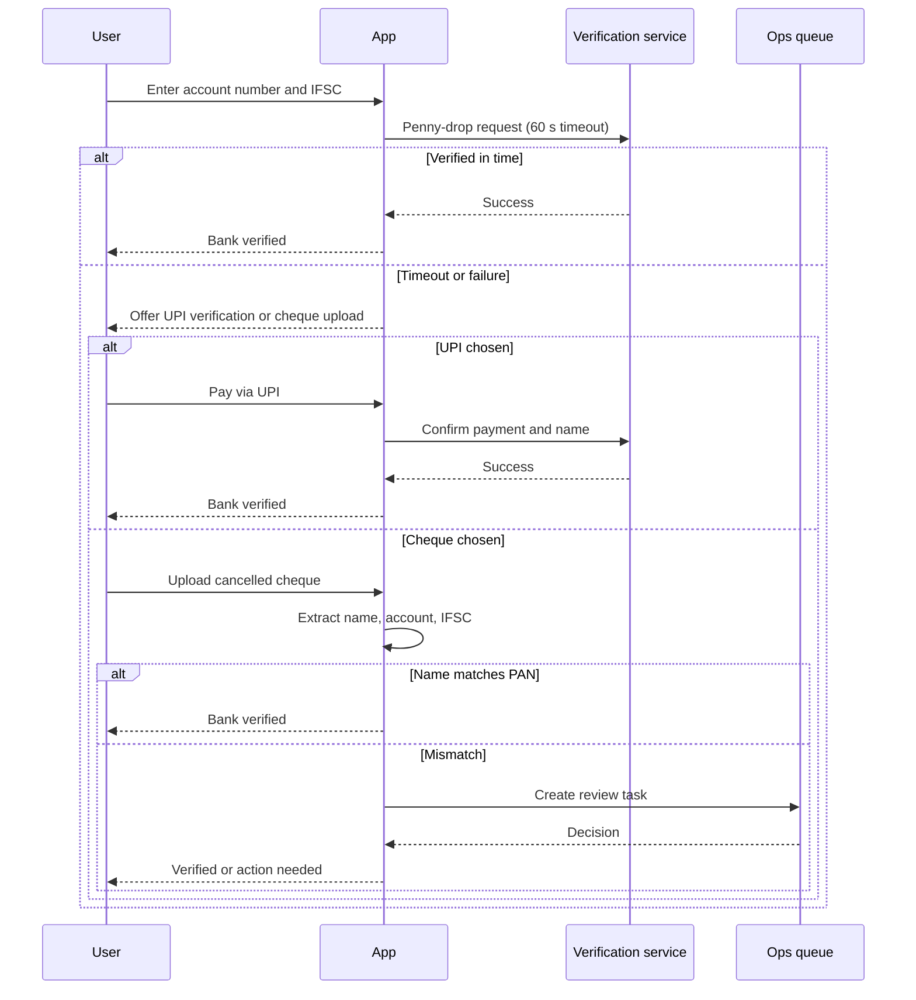

# Process Flows

Diagrams use Mermaid and render on GitHub. Loss percentages are the share of **all sign-ups** lost at that step.

## 1. As-is onboarding flow

**Pain points**
| Step | Pain point | Evidence |
|---|---|---|
| KYC | Aadhaar-mobile mismatch ends the journey; late-night starters leave and do not return | F1, F2, F4 |
| Bank | Slow penny-drop responses and unsupported co-operative banks | F3 |
| Selfie / IPV | Failures on low-end devices and web | F5 |
| Signature | Offline users must print, sign and courier | F2 |
| Funding | No guided path from approval to first deposit | F7 |
| All | Reasons for drop-off are unknown for 36.8% of cases | F8 |

## 2. To-be onboarding flow

Green boxes are new or changed. Sign-off from Compliance is required for the alternative KYC and signature steps.

## 3. Application status model

## 4. Bank verification with fallback (sequence)

